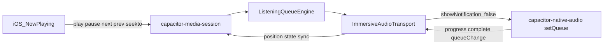

# 沉浸式 iOS 锁屏播放器（Now Playing）

> 核对日期：2026-11-21。  
> 专项文档：学习本沉浸式 Immersive 在 **iOS** 上的锁屏 / 控制中心 Now Playing。  
> 产品面差异与通用音频排障见 [听力与音频播放排障手册](./听力与音频播放排障手册.md)；存播总览见 [离线学习与沉浸式播放器手册](./离线学习与沉浸式播放器手册.md)。

---

## 1. 定位

| 是 | 不是 |
|----|------|
| 学习本「练听力」→ `ImmersivePlayerDialog` | 听力学习包会话页（WebView `<audio>`，锁屏弱） |
| iOS `MPNowPlayingInfoCenter` + `MPRemoteCommandCenter` | VN / 剧本舞台配音 |
| NativeAudio 队列出声 + MediaSession 独占系统卡 | Android 后台通知（本专项不覆盖） |

**平台：iOS only。** JS 侧 `immersive-media-session.ts` 用 `isIOS()` 门控；Android 另开需求。

---

## 2. 架构：双插件分工

两边都碰同一套系统 API（`MPNowPlayingInfoCenter` / `MPRemoteCommandCenter`）。设计上必须 **独占写卡方**，否则进度闪回、一次按键双触发。

| 插件 | 版本 | 职责 |
|------|------|------|
| `@capgo/capacitor-native-audio` | `^8.5.4` | 实际出声、后台续播、官方 `setQueue` 队列 |
| `@capgo/capacitor-media-session` | `^8.1.11` | **独占**系统 Now Playing；不负责解码播放 |

要点：

1. **锁屏控制**：MediaSession → metadata / playbackState / position；actions：play、pause、nexttrack、previoustrack、seekto（**无 ±15**）。
2. **播放本体**：NativeAudio + `backgroundPlayback: true`。
3. **`showNotification: false`**：关掉 Capgo 自带通知卡，避免与 MediaSession 双写 Now Playing。
4. **队列**：`NativeAudio.setQueue`（段音频 + 静音 gap 轨）；权威在 `ListeningQueueEngine`。

控制入口约定：

| 来源 | 行为 |
|------|------|
| 锁屏卡 MediaSession action | Engine `resume()` / `pause()` / `next` / `prev` / `seekTo`（会真正驱动 Transport） |
| NativeAudio `remotePlay` / `remotePause` | **只 sync** Engine/UI 状态；**禁止再调** `transport.resume()` / `pause()` |
| 后台自动下一首 | Engine `complete` → `queueNext`（不是锁屏 action） |

---

## 3. 关键代码

| 文件 | 职责 |
|------|------|
| `listening-queue.engine.ts` | 队列权威；`ensureLockScreenSession`；remote 只 sync；跨学习项 next/prev |
| `immersive-playback.service.ts` | Transport：`configure({ showNotification: false })`、`setQueue`、progress → MediaSession position |
| `immersive-media-session.ts` | MediaSession 封装（仅 iOS） |
| `immersive-player-dialog.tsx` | UI；回前台时若 transport 已 `playing` 则 **skip** resume |
| `immersive-silence.ts` | 句间静音 WAV 进官方队列 |

入口：`expression-library-page` → `useLeanInsightPlaylist` → `ImmersivePlayerDialog`。

---

## 4. 硬规则

1. Native 只喂 `file://`（`resolvePlaybackAudio({ asFileUri: true })`）。
2. **禁止**把沉浸式的 Capgo `showNotification` 设回 `true`（与 MediaSession 双写 → 进度闪回）。
3. MediaSession play/pause → Engine；NativeAudio remotePlay/Pause → 只 sync。
4. 无 ±15 skip；拖进度走 `seekto` → Transport `setCurrentTime`。
5. 后台禁止新 TTS；后台 0 gap（不插静音轨）。
6. 关窗必须停播并 `clearMediaSession`。
7. 改 native 插件后必须 `cap sync ios` 再打真机包。

---

## 5. 已规避（当前缓解）

| 冲突面 | 现状 |
|--------|------|
| Now Playing 双写 | Transport `showNotification: false`；不写 Capgo 通知卡 |
| Capgo remote 改写 elapsed | 关通知后 Capgo 不再刷自己的 Now Playing |
| Remote command 叠层 | Capgo handler 在 `showNotification == false` 时 early-return；MediaSession `removeTarget(nil)` 再挂自己的 |
| Capgo ±15 / scrub | configure 时关掉 skip / changePlaybackPosition（MediaSession 自己开 seekto） |
| JS 双 resume | Engine `syncFromRemotePlay` / `syncFromRemotePause` 不调 transport |
| 回前台二次 resume | Dialog：visual 已是 `playing` 则 skip |
| 倍速 / elapsed clamp | 本地 ManYu 改动（见 P0：尚未进仓库 `patchedDependencies`） |
| Audio session 类别 | `background: true` 时仍用纯 `.playback`，即使 `showNotification: false`，好让外部 MediaSession 能发布 Now Playing |

---

## 5.1 实现阶段

| 阶段 | 内容 | 状态 |
|------|------|------|
| **Phase 1** | pause/resume 三路冲突处理（`lockscreen` / `ui` / `remote-sync`）+ 幂等；毫秒日志（`tMs` / `positionMs` / `durationMs`）；MediaSession 独占架构注释 | 进行中（代码） |
| 后续 | P0 patch 入库、切歌边界、gap Now Playing、Android | 未开始 |

真机滤日志：`[MANYU_IMMERSIVE]` + `lockscreen.`（如 `lockscreen.pause.enter`、`lockscreen.position.push`、`lockscreen.remote.syncPause`）。

---

## 6. 待处理问题

> **P0 是前提**：native 修复若不能持久化，真机行为在新机器 / CI 上不可复现。

> Phase 1 已覆盖部分 **P1**（configure 红线注释）、**P3**（source 约定 + 单测）、**P4**（Engine resume 幂等）。其余仍见下表。

### P0 — Capgo ManYu patch 未进仓库（阻塞）

- **现象**：锁屏倍速不闪、elapsed clamp、remote no-op、`.playback` 等行为依赖本机 `node_modules/.pnpm_patches/@capgo/...`。
- **根因**：[`package.json`](../package.json) `pnpm.patchedDependencies` 目前只有 wechat / sentry；**没有** `capacitor-native-audio@8.5.4` / `capacitor-media-session@8.1.11`。`patches/` 目录也没有对应文件。
- **修法**：
  1. `pnpm patch @capgo/capacitor-native-audio@8.5.4` / `pnpm patch @capgo/capacitor-media-session@8.1.11`
  2. 把现有 ManYu 改动打进 patch，提交到 `patches/`
  3. 登记 `patchedDependencies`
  4. 干净环境 `pnpm i` → `cap sync ios` → 按 §7 验收

### P1 — 误开 `showNotification: true`

- **现象**：锁屏进度闪回；与 MediaSession 双写。
- **修法**：Transport `configure` 写死 `false`；单测断言；代码注释红线（本文 §4.2）。

### P2 — Capgo 仍 `addTarget`，依赖注册顺序

- **现象**：`showNotification == false` 时 Capgo 仍挂 remote target（空过 `.success`）；与 MediaSession `removeTarget(nil)` 谁后注册谁生效，顺序脆。
- **修法**（native-audio patch）：false 时不挂 / 卸掉 play·pause·next·prev·seek target；或 Transport configure 之后强制 MediaSession 再 `ensureHandlers` 一次。

### P3 — 控制入口分叉

- **现象**：锁屏卡走 MediaSession→Engine；耳机等可能落到 NativeAudio remote→只 sync。路径不一致时易再踩双调。
- **修法**：保持本文 §2 约定；保证两条路径互不双调；补单测（已有 remote sync；补 MediaSession handler → `resume`/`pause`）。

### P4 — 回前台 / appState 与锁屏 resume 重入

- **现象**：已在播又 `resume` → 进度往后跳。
- **修法**：保持 Dialog「已 playing 则 skip」；评估 Engine 层 resume 幂等锁。

### P5 — 静音 gap 轨影响锁屏 duration

- **现象**：句间 gap 进官方队列时，锁屏 duration 短暂变成 gap 轨长度（为避免 `-:--`）。
- **修法**：文档标为**当前预期**；后续可评估 gap 期间冻结上一轨 Now Playing duration（MediaSession 策略）。

### P6 — 队列窗尾 remote next 与跨学习项

- **现象**：Native 队列窗内 next/prev 与跨学习项 `Engine.next`/`prev` 是两层；窗尾边界脆。
- **修法**：写清「窗内切段 / 窗尾跨项」；补边界单测；必要时 remote 一律走 `Engine.next`/`prev`。

### P7 — Android 无本模型

- **现象**：无 MediaSession 独占路径。
- **修法**：本专项标明 iOS only；Android 后台/通知另开需求，不在此扩。

---

## 7. 真机验收清单

1. 前台连播 ≥5 条 + gap  
2. 播放中锁屏 ≥1 分钟，**音频仍自动下一首**，系统 Now Playing 卡可见  
3. 锁屏 pause → play：**进度不闪前再跳回**；拖进度条后音频与进度条对齐  
4. 锁屏上一首 / 下一首切学习条目；回前台 UI index 与音频一致  
5. 关窗后播放停止  

升级依赖或 patch 后：`cap sync ios`，再跑本清单。

---

## 8. 诊断

| 手段 | 用途 |
|------|------|
| 控制台滤 `[MANYU_IMMERSIVE]` | 播放链路（含 `mediaSession.*`、`engine.remotePlay.sync` 等） |
| `MANYU_AUDIO_DIAG` | 资源解析 URL 形态 |
| 单元测试 | `pnpm --filter @manyu/frontend exec vitest run src/features/learning/components/immersive-player` |

排障入口（切歌断链 / 回前台丢声）：[听力与音频播放排障手册](./听力与音频播放排障手册.md) §E / §F，细节以本文为准。

---

## 9. 相关文档

| 文档 | 用途 |
|------|------|
| [听力与音频播放排障手册](./听力与音频播放排障手册.md) | 三条产品面对照、听力页、通用排障 |
| [离线学习与沉浸式播放器手册](./离线学习与沉浸式播放器手册.md) | 存播、装包、沉浸式总览 §12 |
