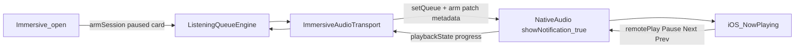

# 沉浸式 iOS 锁屏播放器（Now Playing）

> 核对日期：2026-11-22。  
> 专项文档：学习本沉浸式 Immersive 在 **iOS** 上的锁屏 / 控制中心 Now Playing。  
> 产品面差异与通用音频排障见 [听力与音频播放排障手册](./听力与音频播放排障手册.md)；存播总览见 [离线学习与沉浸式播放器手册](./离线学习与沉浸式播放器手册.md)。

> **状态：目标架构（文档已定，代码未迁）。**  
> 仓库里沉浸式仍是 **双插件**：`showNotification: false` + `@capgo/capacitor-media-session`（见 `immersive-media-session.ts`）。  
> 本文描述的是下一阶段设计：**仅** `@capgo/capacitor-native-audio` + `showNotification: true`，并支持 **打开 Immersive 即出暂停态锁屏卡**。实现前勿按本文改配置误开双写。

---

## 1. 定位

| 是 | 不是 |
|----|------|
| 学习本「练听力」→ `ImmersivePlayerDialog` | 听力学习包会话页（WebView `<audio>`，锁屏弱） |
| iOS `MPNowPlayingInfoCenter` + `MPRemoteCommandCenter` | VN / 剧本舞台配音 |
| **仅** NativeAudio 出声 + 自带 Now Playing 卡 | 再挂 `@capgo/capacitor-media-session` |

**平台：iOS 优先。** `showNotification: true` 后 Android 通知可一并跟进，但本专项验收以 iOS 为准；Android 细节另开需求时再扩。

---

## 2. 架构：仅 NativeAudio

一套系统 API（`MPNowPlayingInfoCenter` / `MPRemoteCommandCenter`）只允许 **一个写卡方**。目标设计里写卡方就是 Capgo NativeAudio 自己（`showNotification: true`），不再引入 MediaSession。播起来之后，**出声与锁屏卡同一插件**，不需要再经 JS MediaSession「同步过去」。

| 插件 | 版本 | 职责 |
|------|------|------|
| `@capgo/capacitor-native-audio` | `^8.5.4` | 出声、后台续播、`setQueue`、**系统 Now Playing / 通知卡**、remote 控制 |
| `@capgo/capacitor-media-session` | — | **沉浸式路径目标删除**；勿再注册 action / metadata |

要点：

1. **`configure({ showNotification: true, background: true, backgroundPlayback: true })`**：Capgo 写锁屏卡；音频 session 为可打断其它 App 的 `.playback`（音乐 / 播客类主音源）。
2. **队列项必须带 `notificationMetadata`**（title / artist / album / artworkUrl），否则卡上元数据空洞。
3. **队列**：`NativeAudio.setQueue`（段音频 + 静音 gap 轨）；权威仍在 `ListeningQueueEngine`。
4. **锁屏按钮目标**：多轨时 **上一首 / 下一首（学习项）**；拖进度走插件 seek。Capgo 默认 ±15 skip 若与产品冲突，用 configure / patch 关掉或改槽位，**不**为此重新引入 MediaSession。
5. **本阶段倍速锁 1**（产品与 Now Playing `playbackRate`）；非 1 倍速放到最后再做。



控制入口约定（目标：单一路径）：

| 来源 | 行为 |
|------|------|
| 锁屏 / 耳机 remote（`remotePlay` / `remotePause` / `remoteNext` / `remotePrevious`） | Engine **直接驱动** Transport（resume / pause / next / prev）；**禁止**「只 sync UI、再二次调 transport」导致双调 |
| UI 播放 / 暂停 | Engine → Transport（与 remote 同一套方法） |
| 后台自动下一首 | Engine `complete` → `queueNext`（不是锁屏 action） |

---

## 3. 打开即出卡（Arm Session）

产品约定：打开学习本 Immersive drawer **尚未点播放**时，锁屏 / 控制中心已出现 Now Playing 卡，状态为 **paused**，展示当前条目元数据；用户点卡上 play 或 UI 播放才出声。关窗后卡消失。

| 步骤 | 行为 |
|------|------|
| Dialog `open=true` | Engine `armSession(currentItem)` |
| Transport | `configure(showNotification: true)` → 解析首段 `file://` → `setQueue({ items, startIndex: 0, autoPlay: false })` + 完整 `notificationMetadata` |
| 系统卡 | **默认靠 native patch** 在 `setQueue` / arm 时写入 Now Playing（`playbackRate = 0`） |
| 用户 play（UI 或锁屏） | `resume` / `play` 真正出声；写卡 `playbackRate = 1` |
| Dialog close | `stop` + `clearQueue`，清卡 |

### 3.1 默认方案：native-audio patch

Capgo 公开文档写的是 play 之后通知才出现。本项目 **默认不赌** `autoPlay: false`  alone 能出卡。

**默认（实现必做）**：`@capgo/capacitor-native-audio` 的 `pnpm patch`——在 `setQueue` / arm 时写 `MPNowPlayingInfoCenter`（title / artwork / duration / `elapsed = 0`，**`playbackRate = 0`**），不依赖先出声；patch 入库 `patches/` + `patchedDependencies`。

对照说明（非主路径）：

- 仅 `setQueue({ autoPlay: false })` + metadata：可作为对照观察，**不**当作交付依赖。
- play-then-pause（极短播再停）：**不推荐**（可能闪一声），仅极端兜底。

「打开 Immersive → 不点播放 → 立刻锁屏有 paused 卡」是实现阶段的 **硬验收项**。

---

## 4. Now Playing 进度策略

其它播放器（Music / Spotify）的做法：

1. **播中**用 `elapsed + rate=1` 墙钟插值 → 条丝滑。
2. **播中约每 0.1s** 把字典 `elapsed` **安静 rebase 到当前 visual**，`rate` 仍为 `1`（用户无感）。间隔过大时暂停仍会带着 `jumpFromSys≈npAge` 闪。
3. **暂停**：字典落后时先 `pauseBridge`（同 pin、`rate=1`）再同轮写 `rate=0`（依赖 0.1s rebase 把 jump 压小）。锁屏 play/pause **串行 + coalesce**（`remoteDesiredPlaying`），禁止在 settle 中叠第二次 freeze/arm。

系统没有「把条绑到 AVAudioPlayer」的 API；`rate=1` 本来就是墙钟。若整段只 arm 一次、播中永不改 elapsed，暂停时字典仍是旧基准、条已插值走远 → `jumpFromSys` 很大 → iOS 收 `rate=0` 时往回闪。这是反复修 pause 顺序仍闪的**根因**。

短句启动延迟会让 player 慢半拍——开播时**等 `currentTime` 离开 0 再 arm `rate=1`**。暂停冻 visual，并 seek player 到同一点，恢复也对齐。

硬约定：

1. **播中 `rate=1`**；JS progress **不得**写 NP（只服务 App 内 UI）。
2. **play / 切轨**：先 metadata + `rate=0` @0；player 动了再 `publishPlaying.arm` → live elapsed + `rate=1`，并启动 quiet rebase。
3. **播中允许 quiet rebase**：只把 `elapsed` 写成**当前 visual**（已显示位置），`rate` 保持 `1`。**禁止**写成明显落后的 player（那才会闪回）。
4. **暂停**：先可选 `pauseBridge`（同 pin、`rate=1` 对齐字典），再 `rate=0` 冻 visual；`timeBeforePause` 同值；seek player 会合。验收：`jumpFromSys` 应在 **±0.05s** 量级。
4b. **恢复**（seek 已到位后）：先写 NP `elapsed=pin, rate=1`，**再** `asset.resume()`（`publishResumeArmThenPlay`）。禁止先出声再 hold/arm——声会领先条 ~20ms，体感「点播放往前闪」。
5. **轨尾**：永远不要强行写 100%（`leaveCard`）；交给下一首 `publishPlaying` 或 `clearQueue`。
6. **禁止**在 `audioQueue` 里 `main.sync`（Capacitor 会死锁卡死）。
7. **armSession** 只开窗一次；换项直接 `playQueue`。
8. generation 丢弃过期 async 写；quiet rebase **不** bump generation（freeze/reset bump 后自动停）。

目标：连贯如系统播放器；暂停不闪。

---

## 5. 相关代码（目标态）

| 文件 | 职责 |
|------|------|
| `listening-queue.engine.ts` | 队列权威；`armSession`；remote → 直接驱动 Transport；跨学习项 next/prev；窗尾滑窗 |
| `immersive-playback.service.ts` | Transport：`showNotification: true`、`setQueue` + metadata、状态点写 Now Playing（见 §4） |
| `immersive-media-session.ts` | **目标删除**；迁移完成前仍是旧双插件写卡方，勿与新设计并存 |
| `immersive-player-dialog.tsx` | UI；`open` 时触发 arm；回前台若已 `playing` 则 skip 二次 resume |
| `immersive-silence.ts` | 句间静音 WAV 进官方队列 |
| `patches/@capgo__capacitor-native-audio@…` | arm 写卡（`playbackRate = 0`）；按需 elapsed clamp / skip 槽位 |

入口：`expression-library-page` → `useLeanInsightPlaylist` → `ImmersivePlayerDialog`。

---

## 6. 硬规则

1. Native 只喂 `file://`（`resolvePlaybackAudio({ asFileUri: true })`）。
2. 沉浸式 **`showNotification: true`**；队列项带 `notificationMetadata`。
3. **禁止**在沉浸式路径再挂 `@capgo/capacitor-media-session`（双写 → 进度闪回 / 按键双触发）。
4. Remote 与 UI 共用 Engine 驱动路径；禁止 remote「只 sync」再叠一层 resume/pause。
5. Now Playing：播中 `rate=1` + visual quiet rebase、暂停 `rate=0`（见 §4）。
6. **本阶段不做倍速**（UI / Now Playing 均按 1）；非 1 留到最后。
7. 锁屏交互优先 **上下曲（学习项）+ 拖进度**；±15 若与产品冲突则 configure/patch，不引 MediaSession。
8. 后台禁止新 TTS；后台 0 gap（不插静音轨）。
9. 关窗必须停播并 `clearQueue`（卡随之消失：关掉 Immersive 界面后锁屏不应再挂卡、不应再出声）。
10. 改 native 插件 / patch 后必须 `cap sync ios` 再打真机包。

---

## 7. 实现阶段

| 阶段 | 内容 | 状态 |
|------|------|------|
| **Docs** | 目标架构 + 进度策略 + 交叉手册 | 完成（含本次） |
| **Arm patch + 单插件** | 卸 MediaSession；`showNotification: true`；arm patch 出 paused 卡；remote 单路径；rate=1 | 未开始 |
| **窗尾换窗硬修** | 优先 `addTracks` 滑窗；remote 走 Engine；换窗无空卡（R5 必做） | 未开始 |
| **真机验收** | §9 清单 | 未开始 |

**本阶段明确延后**：UI ↔ 锁屏完全同拍、gap 期间冻结 metadata 显示、倍速（非 1）。

真机滤日志：统一前缀 `[MANYU_IMMERSIVE]`（`js.*` + `native.*`），见 §10。

---

## 8. 风险与待处理（目标架构）

旧双插件问题（MediaSession 注册顺序、误开 `showNotification` 与 MediaSession 双写等）在单插件落地后作废。新风险：

### R1 — 打开即出卡（默认 patch）

- **现象**：官方路径往往要 play 后才出通知；仅 `autoPlay: false` 可能不出卡。
- **修法（默认）**：§3.1 native-audio patch，在 `setQueue` / arm 写 `MPNowPlayingInfoCenter`（`playbackRate = 0`）；入库 `patchedDependencies`。

### R2 — elapsed 闪回 / 顿挫

- **现象**：remote pause/play 或周期性写 elapsed 导致 scrubber 闪前再跳回、一顿一顿。
- **修法**：落实 §4（播中 rate=1 + visual quiet rebase；状态点更新）。禁止把落后的 player 当 elapsed 写回。  
- **本阶段**：闪回 **不挡主路径**；验收要求「不严重闪回」，不要求零闪回。

### R3 — ±15 vs 上一首 / 下一首

- **现象**：Capgo 默认 skip ±15 占锁屏左右槽，与「切学习项」冲突。
- **修法**：configure 关掉 skip 或改槽位；多轨队列露出 prev/next；必要时 patch。

### R4 — 静音 gap 轨（显示瞬跳，非时钟漂移）

- **现象**：进 gap 时锁屏 duration/position 短暂变成 gap 轨；出 gap 再跳回内容轨。静音 WAV 时长准时，**音频队列不会越播越偏**。
- **修法**：**延后**——本阶段标为已知显示瞬跳；后续可评估 gap 期间冻结上一句 Now Playing metadata。

### R5 — 队列窗尾 / `setQueue` 换窗（必须修复）

- **现象**：窗尾 next 或整窗 `clear + setQueue` 时卡空白、title/进度与音频错位。
- **修法（必做）**：优先 `addTracks` 滑窗、少整窗重建；remote 一律 `Engine.next`/`prev`；换窗前备好下一段 `file://` + metadata，保证无空卡。硬验收见 §9。

### R6 — 回前台 / UI ↔ 锁屏同拍（本阶段不优先）

- **现象**：已在播又 `resume` → 进度跳；或 Dialog 与锁屏短暂不一致。
- **修法**：Dialog「已 playing 则 skip」；Engine resume 幂等。  
- **优先级**：先保证 **锁屏卡与音频**；UI 完全同拍延后。

### R7 — Android 通知

- **现象**：本专项以 iOS 验收为主；`showNotification: true` 后 Android 也会出通知。
- **修法**：Android 另开需求；实现单插件时至少冒烟，不阻塞 iOS 主路径。

---

## 9. 真机验收清单

1. **打开 Immersive、不点播放**，立刻锁屏 → **有卡、paused、元数据正确**  
2. 卡上 play → 出声；playing 时 scrubber **连贯**（`rate=1` 插值，无步进）  
3. pause / seek / 切轨后 elapsed 与真实位置对齐；暂停**不闪**  

4. 暂停后卡仍在；**关窗后卡消失**、播放停止  
5. 前台连播 ≥5 条 + gap  
6. 播放中锁屏 ≥1 分钟，**音频仍自动下一首**，系统卡可见  
7. 锁屏 pause → play：**不严重闪回**；拖进度后音频与 scrubber 对齐  
8. **窗尾连续下一首**：卡 title/进度与音频同一切换，**无空白卡**、不停播  
9. 锁屏上一首 / 下一首切学习条目  

本阶段不验收倍速。升级依赖或 patch 后：`cap sync ios`，再跑本清单。

---

## 10. 诊断

**统一前缀**：JS 与 Capgo 都打 `[MANYU_IMMERSIVE]`（Xcode / Safari 滤这一个即可）。  
事件分层：`js.*`（WebView） / `native.*`（Swift）。一行 `key=value`，便于对时序。

### 时钟字段（看暂停闪必看）

| 字段 | 含义 |
|------|------|
| `player` | `AVAudioPlayer.currentTime` |
| `visual` | 锁屏条当前位置 ≈ `lastNp + npRate × npAge` |
| `deltaVP` | `visual − player`；**`+` = 条在声前面**（若写 player 会闪回） |
| `lastNp` / `npRate` / `npAge` | 上次写 NP 的基准与墙钟年龄 |
| `pin` / `pinSource` / `staleClock` | 暂停冻结决策（`visual` 或 `playerFallback`） |
| `sysElapsed` / `jumpFromSys` | 写卡前系统卡上的 elapsed，以及本次写入相对它的跳变 |
| `flashRisk` | `|deltaVP| > 0.05` |
| `writeRate` | 本次写入的 `rate`（播中 1 / 暂停·hold 0） |

### 暂停闪排查顺序（锁屏点暂停）

```
js.engine.remote.pause
→ native.remote.pause          # player / visual / deltaVP
→ native.np.freeze             # pinSource / jumpFromSys / flashRisk
→ native.clock.write reason=freezePause
→ (可选) native.np.freeze.seek
```

App 内点暂停：

```
js.engine.pause → js.transport.pause.enter
→ native.pause → native.np.freeze → …
```

恢复：

```
… → native.np.resumeHold (rate=0)
→ native.np.arm (rate=1, live player)   # 不应再出现立刻 rate=1 fromPause
```

### 事件速查

| 前缀 | 场景 |
|------|------|
| `js.engine.*` / `js.transport.*` | Engine / Transport 意图 |
| `native.remote.*` / `native.pause` / `native.resume` / `native.play.*` | 遥控与播控入口 |
| `native.np.*` | Now Playing 写卡（`meta` / `arm` / `quietRebase` / `pauseBridge` / `freeze` / `resumeHold` / `clockReset`） |
| `native.clock.write` | 本地双钟基准更新 |
| `native.queue.*` | setQueue / clear / next / playAsset |

| 其它 | 用途 |
|------|------|
| `MANYU_AUDIO_DIAG` | 资源解析 URL 形态 |
| 单元测试 | `pnpm --filter @manyu/frontend exec vitest run src/features/learning/components/immersive-player` |

**已知根因与 patch 对策**（`patches/@capgo__capacitor-native-audio@8.5.4.patch`）：

| 现象 | 根因 | patch |
|------|------|-------|
| 点暂停还在播 | `ignorePlayBounce` / `elapsed<0.08` 吞掉真暂停 | **禁止**忽略 remotePause；一律真暂停 |
| 每轨第一次暂停闪、之后好 | arm 用了过期 currentTime；封面异步写回把 elapsed 打回旧基准；暂停/恢复才校准 | arm 写卡时当场重采 currentTime；artwork merge 按 visual 续写 elapsed+rate |
| 切轨后马上暂停大闪 | 上一首 `rate=1` 时钟未清，visual=旧基准+npAge，player 仍为 0 | 切轨 `npClock.reset`；pause 若 staleClock 则冻 player |
| 快播完闪到 100% / 末尾卡死 | leaveCard 写 duration；`audioQueue→main.sync` 死锁 | 取消 leaveCard；NP 写只用 `main.async` |
| 恢复后条先到 ~100%、声落后；下次 pause `deltaVP` 很大 | resume 立刻 `rate=1`，墙钟超前 player | `native.np.resumeHold` rate=0，等 player≥pin 再 arm |
| 暂停向后闪进度 | 字典 elapsed 老化；同帧 bridge+rate0 被系统合并；或先 pause | **0.1s quiet rebase**；暂停 **bridge → yield → rate0（`freeze.rate0` 的 jumpFromSys≈0）→ pause** |
| 已播新音频、卡还像上一首 | `playQueueAsset` 先 `play`，`updateNowPlayingInfo` 又晚一拍 async | 切轨前同步推新轨 metadata，`elapsed=0` / `rate=1` |

改 patch 后：`pnpm i` → `pnpm --filter @manyu/frontend exec cap sync ios`，滤 `[MANYU_IMMERSIVE]` 对时序。

排障入口（切歌断链 / 回前台丢声）：[听力与音频播放排障手册](./听力与音频播放排障手册.md) §E / §F，锁屏细节以本文为准。

---

## 11. 相关文档

| 文档 | 用途 |
|------|------|
| [听力与音频播放排障手册](./听力与音频播放排障手册.md) | 三条产品面对照、听力页、通用排障 |
| [离线学习与沉浸式播放器手册](./离线学习与沉浸式播放器手册.md) | 存播、装包、沉浸式总览 §12 |

---

## 附录：旧双插件（当前代码，迁移前）

迁移完成前代码行为摘要（**勿当作目标设计**）：

- Transport：`showNotification: false`
- `immersive-media-session.ts` 独占写卡；NativeAudio remote 只 sync；JS 周期性 `setPositionState`
- 硬规则曾禁止把 `showNotification` 设回 `true`（避免与 MediaSession 双写）

单插件落地后删除本附录，并删除 `immersive-media-session.ts`。
