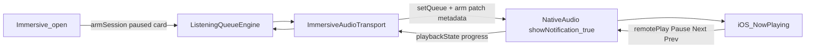

# 沉浸式 iOS 锁屏播放器（Now Playing）

> 核对日期：2026-11-22。  
> 专项文档：学习本沉浸式 Immersive 在 **iOS** 上的锁屏 / 控制中心 Now Playing。  
> 产品面差异与通用音频排障见 [听力与音频播放排障手册](./听力与音频播放排障手册.md)；存播总览见 [离线学习与沉浸式播放器手册](./离线学习与沉浸式播放器手册.md)。

> **状态：目标架构（文档已定，代码未迁）。**  
> 仓库里沉浸式仍是 **双插件**：`showNotification: false` + `@capgo/capacitor-media-session`（见 `immersive-media-session.ts`）。  
> 本文描述的是下一阶段设计：**仅** `@capgo/capacitor-native-audio` + `showNotification: true`，并支持 **打开 Immersive 即出暂停态锁屏卡**。实现前勿按本文改配置误开双写。

---

## 1. 定位

| 是 | 不是 |
|----|------|
| 学习本「练听力」→ **App 级 Immersive 会话**（`ImmersiveSessionHost` + `ImmersivePlayerDialog`） | 听力学习包会话页（WebView `<audio>`，锁屏弱） |
| iOS `MPNowPlayingInfoCenter` + `MPRemoteCommandCenter` | VN / 剧本舞台配音 |
| **仅** NativeAudio 出声 + 自带 Now Playing 卡 | 再挂 `@capgo/capacitor-media-session` |

**会话生命周期（产品约定）**：Immersive 是 **App 级会话**，不绑在学习本页面卸载上。

- App 内任意路由切换：未点 Immersive 关闭 → **音频继续**，Dialog 仍在根层
- 长时间后台 / 冷启动：恢复到 `/expressions/:notebookId`，重新打开 Immersive UI；native 仍有资源则 `resume`，否则 `armSession` 暂停卡（不强制自动出声）
- 用户点关闭 / 睡眠定时结束：清会话 + `clearSession`（清 Now Playing）

**平台：iOS 优先。** `showNotification: true` 后 Android 通知可一并跟进，但本专项验收以 iOS 为准；Android 细节另开需求时再扩。

---

## 2. 架构：仅 NativeAudio

一套系统 API（`MPNowPlayingInfoCenter` / `MPRemoteCommandCenter`）只允许 **一个写卡方**。目标设计里写卡方就是 Capgo NativeAudio 自己（`showNotification: true`），不再引入 MediaSession。播起来之后，**出声与锁屏卡同一插件**，不需要再经 JS MediaSession「同步过去」。

| 插件 | 版本 | 职责 |
|------|------|------|
| `@capgo/capacitor-native-audio` | `^8.5.4` | 出声、后台续播、`setQueue`、**系统 Now Playing / 通知卡**、remote 控制 |
| `@capgo/capacitor-media-session` | — | **沉浸式路径目标删除**；勿再注册 action / metadata |

要点：

1. **`configure({ showNotification: true, background: true, backgroundPlayback: true })`**：Capgo 写锁屏卡；音频 session 为可打断其它 App 的 `.playback`（音乐 / 播客类主音源）。
2. **队列项必须带 `notificationMetadata`**（title / artist / album / artworkUrl），否则卡上元数据空洞。`artworkUrl` **只写可加载的 `file://` logo**（开播前 `warmupImmersiveArtwork` / `ensureArtworkUri`）；失败则省略，禁止 WebView/http 回退。
3. **队列**：内容轨 + **独立静音 gap 轨**（`immersive-silence.ts` → Cache WAV）。规则：单词→例句 **1s gap**；其余（例句→下词、词→词、项间）**X=`pauseGapSeconds` gap**。锁屏后台同样生效（真实音频，不靠 JS timer / WebView decode）。Capgo 对 `immersive:gap:*` **不改写 Now Playing**，条停在上一段 100% 直到 gap 播完。倍速时静音文件按 `silenceSec * rate` 加长，墙钟仍约等于设定秒数。
4. **锁屏按钮**：**上一首 / 下一首（学习项）+ 拖进度**；Capgo patch **关掉 ±15 skip**（`skipForward/Backward.isEnabled = false`），**不**再引 MediaSession。
5. **倍速**：设置 0.75 / 1 / 1.25 / 1.5 传到 `NativeAudio.setRate`；Now Playing 由 `NowPlayingClock` 播中写**实际 rate** 并 visual tick（见 §4）。
6. **队列播完**：未开 `loopQueue` → 回到 list 第 1 项并 `armSession` 暂停（不清 Now Playing）；开了 `loopQueue` → 从第 1 项继续播。



控制入口约定（目标：单一路径）：

| 来源 | 行为 |
|------|------|
| 锁屏 / 耳机 remote（`remotePlay` / `remotePause` / `remoteNext` / `remotePrevious`） | Engine **直接驱动** Transport（resume / pause / next / prev）；**禁止**「只 sync UI、再二次调 transport」导致双调 |
| UI 播放 / 暂停 | Engine → Transport（与 remote 同一套方法） |
| 后台自动下一首 | Engine `complete` → `queueNext`（不是锁屏 action） |

---

## 3. 打开即出卡（Arm Session）

产品约定：打开学习本 Immersive drawer **尚未点播放**时，锁屏 / 控制中心已出现 Now Playing 卡，状态为 **paused**，展示当前条目元数据；用户点卡上 play 或 UI 播放才出声。**显式关窗**后卡消失（路由切换不关窗）。

| 步骤 | 行为 |
|------|------|
| Dialog `open=true` | 有可恢复 native 资源 → `resume`；否则 Engine `armSession(currentItem)` |
| Transport | `configure(showNotification: true)` → 解析首段 `file://` → `setQueue({ items, startIndex: 0, autoPlay: false })` + 完整 `notificationMetadata` |
| 系统卡 | **默认靠 native patch** 在 `setQueue` / arm 时写入 Now Playing（`playbackRate = 0`） |
| 用户 play（UI 或锁屏） | `resume` / `play` 真正出声；写卡 `playbackRate = 1` |
| Dialog close / 睡眠结束 | Host `clearSession` + Engine `stop({ clearSession: true })` → `clearQueue`，清卡 |

### 3.1 默认方案：native-audio patch

Capgo 公开文档写的是 play 之后通知才出现。本项目 **默认不赌** `autoPlay: false`  alone 能出卡。

**默认（实现必做）**：`@capgo/capacitor-native-audio` 的 `pnpm patch`——在 `setQueue` / arm 时写 `MPNowPlayingInfoCenter`（title / artwork / duration / `elapsed = 0`，**`playbackRate = 0`**），不依赖先出声；patch 入库 `patches/` + `patchedDependencies`。

对照说明（非主路径）：

- 仅 `setQueue({ autoPlay: false })` + metadata：可作为对照观察，**不**当作交付依赖。
- play-then-pause（极短播再停）：**不推荐**（可能闪一声），仅极端兜底。

「打开 Immersive → 不点播放 → 立刻锁屏有 paused 卡」是实现阶段的 **硬验收项**。

---

## 4. Now Playing 进度策略（单写时钟）

**实现：** Capgo patch 内 `NowPlayingClock.swift`。`Plugin.swift` / `NativeAudio+Queue.swift` 只发意图，**禁止**直接写 `elapsed` / `playbackRate`。

系统没有「把条绑到 AVAudioPlayer」的 API；进度只认字典 `elapsed + rate` 墙钟插值。多处异步写同一字典是闪回的根因——现已收敛为单一 `commit`。

### 状态机

| State | 含义 |
|-------|------|
| `idle` | 无卡 |
| `armed` | 暂停态开卡（`setQueue` autoPlay:false） |
| `holding` | 切轨后卡面已 @0（或保留上一段 ended），等 `play()` |
| `playing` | rate=倍速；内部 0.1s tick rebase 到 **visual** |
| `frozen` | 暂停，elapsed=pin |
| `ended` | 完成，elapsed=**duration** |

### 意图

| Intent | 行为 |
|--------|------|
| `showArmed` | → armed @ elapsed rate=0 |
| `beginTrack(replaceAtZero)` | 仅需立刻亮出新卡 @0 时（少用） |
| `beginTrack(keepEndedUntilArm)` | **队列开播默认**：不写 NP，保留上一内容 ended，直到 arm |
| `armPlaying(@0)` | 开播同帧 playing@0；每段独立 duration，从 0 起 |
| `armPlaying(resumePin)` | 仅 resume 路径：等 player ≥ pin 再 rate>0 |
| `setRate` | 仅 `playing` 时 visual rebase + 新 rate；否则只改 AVAudioPlayer |
| `pause` | 可选 bridge 后 rate=0；再 pause/seek player |
| `resume` | pin+rate 后出声 |
| `complete` | 钉 duration；keep playing glyph 若队列未空 |
| `clear` | nil 卡 |

### 硬约定

1. **每段独立卡**：duration=本段；开播 `armPlaying.atZero`；gap 钉住上一段结尾。暂停钉 **visual/系统插值**，禁止短轨把条拽回 player（会闪）。
2. Artwork 合并 **只改 artwork**，不改 elapsed/rate。
3. JS progress **不得**写 NP；`setRate` 在 hold/ended 时不抢 arm。
4. 锁屏 remote play/pause 仍 coalesce（`remoteDesiredPlaying`）。
5. **禁止**在 `audioQueue` 里 `main.sync`。
6. 日志统一：`native.np.commit reason=… from=… to=…`（tick / artworkOnly / cancelPending 亦走此前缀）。

目标：连贯如系统播放器；暂停不闪；切轨不回闪。

---

## 5. 相关代码（目标态）

| 文件 | 职责 |
|------|------|
| `listening-queue.engine.ts` | 队列权威；`armSession`；remote → 直接驱动 Transport；跨学习项 next/prev；窗尾滑窗 |
| `immersive-playback.service.ts` | Transport：`showNotification: true`、`setQueue` + metadata；NP 进度由 native `NowPlayingClock` 写（见 §4） |
| `immersive-media-session.ts` | **目标删除**；迁移完成前仍是旧双插件写卡方，勿与新设计并存 |
| `immersive-session.store.ts` | 持久化会话：`notebookId` / `absoluteIndex` / `uiOpen` / `active` / `libraryTab` + 列表筛选 |
| `immersive-session-host.tsx` | 根层 Host：playlist + Dialog；冷启动 navigate + `openAt`；关窗清会话 |
| `immersive-notebook-playlist.ts` | 从 notebookId 构造 lean `fetchPage` / `fetchDetail` |
| `immersive-player-dialog.tsx` | UI；`open` 时 warmup + `resume`（有资源）或 `arm`；回前台若已 `playing` 则 skip 二次 resume |
| `immersive-audio-pad.ts` | `Filesystem.readFile` 解码 → 拼静音 → Cache WAV `file://`；倍速补偿采样 |
| `immersive-silence.ts` | 纯静音 WAV 工具（pad 失败时 timer gap 仍可用其语义） |
| `patches/@capgo__capacitor-native-audio@…` | `NowPlayingClock` 单写；arm / queue / remote；**关闭 ±15**；artwork-only 合并 |

入口：`expression-library-page` → `immersiveSession.startSession(...)` → `RootLayout` 内 `ImmersiveSessionHost` → `useLeanInsightPlaylist` + `ImmersivePlayerDialog`。

---

## 6. 硬规则

1. Native 只喂 `file://`（`resolvePlaybackAudio({ asFileUri: true })`）。
2. 沉浸式 **`showNotification: true`**；队列项带 `notificationMetadata`。
3. **禁止**在沉浸式路径再挂 `@capgo/capacitor-media-session`（双写 → 进度闪回 / 按键双触发）。
4. Remote 与 UI 共用 Engine 驱动路径；禁止 remote「只 sync」再叠一层 resume/pause。
5. Now Playing：`NowPlayingClock` 单写；播中实际 rate + visual tick；暂停 `rate=0`（见 §4）。
6. **倍速解锁**：UI / Transport / Capgo NP 同一 `playbackRate`；改 rate 或 gap 时重建当前窗（尾静音依赖二者）。
7. 锁屏 **仅上下曲（学习项）+ 拖进度**；±15 已在 Capgo patch 关闭。
8. 后台禁止新 TTS；**锁屏后台仍 pad 词间/词句静音**（本地 bake，不依赖网络）。
9. 关窗必须停播并 `clearQueue`（卡随之消失：关掉 Immersive 界面后锁屏不应再挂卡、不应再出声）。
10. 改 native 插件 / patch 后必须 `cap sync ios` 再打真机包。
11. 封面：原生路径只接受 `file://` logo；开播 / arm 前必须物化成功，否则省略 `artworkUrl`。

---

## 7. 实现阶段

| 阶段 | 内容 | 状态 |
|------|------|------|
| **Docs** | 目标架构 + 进度策略 + 交叉手册 | 完成（含本次） |
| **Arm patch + 单插件** | 卸 MediaSession；`showNotification: true`；arm patch 出 paused 卡；remote 单路径 | 进行中 |
| **倍速 + 尾静音 + ±15 off** | rate-aware NP；内容轨 bake silence；关掉 skip | 进行中 |
| **窗尾换窗硬修** | 优先 `addTracks` 滑窗；remote 走 Engine；换窗无空卡（R5 必做） | 未开始 |
| **真机验收** | §9 清单 | 未开始 |

**本阶段明确延后**：UI ↔ 锁屏完全同拍（细粒度）。

真机滤日志：统一前缀 `[MANYU_IMMERSIVE]`（`js.*` + `native.*`），见 §10。

---

## 8. 风险与待处理（目标架构）

旧双插件问题（MediaSession 注册顺序、误开 `showNotification` 与 MediaSession 双写等）在单插件落地后作废。新风险：

### R1 — 打开即出卡（默认 patch）

- **现象**：官方路径往往要 play 后才出通知；仅 `autoPlay: false` 可能不出卡。
- **修法（默认）**：§3.1 native-audio patch，在 `setQueue` / arm 写 `MPNowPlayingInfoCenter`（`playbackRate = 0`）；入库 `patchedDependencies`。

### R2 — elapsed 闪回 / 顿挫

- **现象**：remote pause/play 或周期性写 elapsed 导致 scrubber 闪前再跳回、一顿一顿。
- **修法**：落实 §4（`NowPlayingClock` 单写；播中权威 = visual；状态点经意图更新）。禁止把落后的 player 当 elapsed 写回。  
- **本阶段**：闪回应被单写时钟消灭；验收见 §9 + 下方单写时钟用例。

### R3 — ±15 vs 上一首 / 下一首

- **现象**：Capgo 默认 skip ±15 占锁屏左右槽，与「切学习项」冲突。
- **修法**：**已做** — Capgo patch 禁用 `skipForward` / `skipBackward`；保留 next/previous track。

### R4 — 停顿间隔（锁屏 X 秒）

- **现象（旧）**：bake 进内容依赖 WebView `decodeAudioData`，锁屏下常失败；失败又退回 JS `setTimeout`，后台被挂起 → **听不到 / 看不到停顿**。
- **修法（现）**：独立静音 gap 轨（纯 PCM WAV，无需解码内容）；native `playQueueAsset` 对 `immersive:gap:*` **跳过 NP 写卡**，锁屏条停在上一段结尾满 X 秒。仅当静音文件物化失败才 timer fallback。

### R5 — 队列窗尾 / `setQueue` 换窗（必须修复）

- **现象**：窗尾 next 或整窗 `clear + setQueue` 时卡空白、title/进度与音频错位。
- **修法（必做）**：优先 `addTracks` 滑窗、少整窗重建；remote 一律 `Engine.next`/`prev`；换窗前备好下一段 `file://` + metadata，保证无空卡。硬验收见 §9。

### R6 — 回前台 / UI ↔ 锁屏同拍（本阶段不优先）

- **现象**：已在播又 `resume` → 进度跳；或 Dialog 与锁屏短暂不一致。
- **修法**：Dialog「已 playing 则 skip」；Engine resume 幂等。  
- **优先级**：先保证 **锁屏卡与音频**；UI 完全同拍延后。

### R7 — Android 通知

- **现象**：本专项以 iOS 验收为主；`showNotification: true` 后 Android 也会出通知。
- **修法**：Android 另开需求；实现单插件时至少冒烟，不阻塞 iOS 主路径。

---

## 9. 真机验收清单

1. **打开 Immersive、不点播放**，立刻锁屏 → **有卡、paused、元数据正确**  
2. 卡上 play → 出声；playing 时 scrubber **连贯**（实际 rate 插值，无步进）  
3. pause / seek / 切轨后 elapsed 与真实位置对齐；暂停**不闪**  
4. 暂停后卡仍在；**关窗后卡消失**、播放停止  
5. 前台连播 ≥5 条；词间 / 词句停顿符合 1s / X 规则（锁屏不闪到独立 gap 轨）  
6. 播放中锁屏 ≥1 分钟，**音频仍自动下一首**，系统卡可见  
7. 锁屏 pause → play：**不闪回**；拖进度后音频与 scrubber 对齐  
8. **窗尾连续下一首**：卡 title/进度与音频同一切换，**无空白卡**、不停播  
9. 锁屏上一首 / 下一首切学习条目；**无 ±15**  
10. 改倍速：进度不漂；词间等待墙钟仍约等于设定秒数  
11. 封面稳定为 App logo（`file://`）  
12. **单写时钟专项**（§10 用例 1–4）：短词 EOT、pause/resume、换项 setQueue、锁屏上下曲 — 日志仅 `native.np.commit`

升级依赖或 patch 后：`cap sync ios`，再跑本清单。

---

## 10. 诊断

**统一前缀**：JS 与 Capgo 都打 `[MANYU_IMMERSIVE]`（Xcode / Safari 滤这一个即可）。  
事件分层：`js.*`（WebView） / `native.*`（Swift）。一行 `key=value`，便于对时序。

### 时钟字段（看暂停闪必看）

| 字段 | 含义 |
|------|------|
| `player` | `AVAudioPlayer.currentTime` |
| `visual` | 锁屏条当前位置 ≈ `lastNp + npRate × npAge` |
| `deltaVP` | `visual − player`；**`+` = 条在声前面**（若写 player 会闪回） |
| `lastNp` / `npRate` / `npAge` | 上次写 NP 的基准与墙钟年龄 |
| `pin` / `pinSource` / `staleClock` | 暂停冻结决策（`visual` 或 `playerFallback`） |
| `sysElapsed` / `jumpFromSys` | 写卡前系统卡上的 elapsed，以及本次写入相对它的跳变 |
| `flashRisk` | `|deltaVP| > 0.05` |
| `writeRate` | 本次写入的 `rate`（播中 1 / 暂停·hold 0） |

### 暂停闪排查顺序（锁屏点暂停）

```
js.engine.remote.pause
→ native.remote.pause
→ native.np.commit reason=pause.bridge   # 可选
→ native.np.commit reason=pause.freeze from=playing to=frozen
→ native.np.freeze.playerPaused
→ (可选) native.np.freeze.seek
```

恢复：

```
→ native.np.commit reason=resume from=frozen to=playing
→ native.np.commit reason=tick …          # 播中 rebase
```

### 事件速查

| 前缀 | 场景 |
|------|------|
| `js.engine.*` / `js.transport.*` | Engine / Transport 意图 |
| `native.remote.*` / `native.pause` / `native.resume` / `native.play.*` | 遥控与播控入口 |
| `native.np.commit` | **唯一** Now Playing 进度写（intent / tick / artworkOnly） |
| `native.queue.*` | setQueue / clear / next / playAsset |

| 其它 | 用途 |
|------|------|
| `MANYU_AUDIO_DIAG` | 资源解析 URL 形态 |
| 单元测试 | `pnpm --filter @manyu/frontend exec vitest run src/features/learning/components/immersive-player` |

**已知根因与 patch 对策**（`patches/@capgo__capacitor-native-audio@8.5.4.patch` → `NowPlayingClock`）：

| 现象 | 根因 | patch |
|------|------|-------|
| 点暂停还在播 | `ignorePlayBounce` / `elapsed<0.08` 吞掉真暂停 | **禁止**忽略 remotePause；一律真暂停 |
| 多写竞态闪回 | arm / quietRebase / freeze / complete / artwork 各自写字典 | **唯一** `npClock.commit`；意图表见 §4 |
| 切轨后马上暂停大闪 | 上一首 `rate>0` 时钟未清，visual 老化 | `beginTrack` → `holding`；pause 用 visual pin |
| 快播完闪到 100% / 末尾卡死 | leaveCard 写 duration；`audioQueue→main.sync` 死锁 | `complete` → `ended` @duration；NP 写只用 `main.async` |
| 播完闪回暂停点再切下一项 | complete 后仍 `rate>0`；多路径抢写 | `complete(duration)` rate=0；队列未空 keep playing glyph |
| 短词播完闪开头 / 暂停点 | EOT 后 player≈0 被写成 elapsed | 播中权威 = visual；EOT 回绕进 `ended`，不写 player≈0 |
| 恢复后条超前声 | resume 立刻 rate>0 而 player 未动 | `armPlaying` 等 liveElapsed 种子；可选 resumeHold |
| 暂停向后闪进度 | 字典老化 + 多帧写 | `pause` 内同 pin：可选 bridge 再 freeze（仍只经 `commit`） |
| artwork 偶发闪 | 异步 merge 顺带改写 elapsed/rate | `mergeArtwork` **只改 artwork key** |
| 已播新音频、卡还像上一首 | play 早于换卡 | `beginTrack` 先于 play；再 `armPlaying` |

### 单写时钟真机用例（本专项必过）

1. 短词（&lt;1s）播完 → 例句：条停在 100%，再切到例句进度，**无**回闪到暂停点/开头。  
2. 例句中途锁屏 pause/play 多次：`jumpFromSys` 稳定在 ±0.05s，无 seek 闪回。  
3. 换学习项 `setQueue`：标题换卡 @0 一次，然后 arm，无二次回零。  
4. 锁屏 next/prev：@0 hold ≈160ms 再出声，可接受短暂停顿，无「播完→闪回中间→再跳」。  

日志只应出现 `native.np.commit reason=…`（含 from/to），**不应**再出现并行的 `quietRebase` / `pauseBridge` / `trackSwitch` / `completeFreeze` 各自写字典。

改 patch 后：`pnpm i` → `pnpm --filter @manyu/frontend exec cap sync ios` → Xcode 真机重装，滤 `[MANYU_IMMERSIVE]` 对时序。

排障入口（切歌断链 / 回前台丢声）：[听力与音频播放排障手册](./听力与音频播放排障手册.md) §E / §F，锁屏细节以本文为准。

---

## 11. 相关文档

| 文档 | 用途 |
|------|------|
| [听力与音频播放排障手册](./听力与音频播放排障手册.md) | 三条产品面对照、听力页、通用排障 |
| [离线学习与沉浸式播放器手册](./离线学习与沉浸式播放器手册.md) | 存播、装包、沉浸式总览 §12 |

---

## 附录：旧双插件（当前代码，迁移前）

迁移完成前代码行为摘要（**勿当作目标设计**）：

- Transport：`showNotification: false`
- `immersive-media-session.ts` 独占写卡；NativeAudio remote 只 sync；JS 周期性 `setPositionState`
- 硬规则曾禁止把 `showNotification` 设回 `true`（避免与 MediaSession 双写）

单插件落地后删除本附录，并删除 `immersive-media-session.ts`。
