# 离线学习、学习包与沉浸式播放器手册

> **用途**：漫语町 Web / Capacitor 学习包、资源加载、练习回放、学习库与同步的权威参考。  
> **说明**：以当前代码实现为准（核对日期：2026-11-11）。两端主流程已测通；本文记录**实际怎么走**、关键方法**为什么这么用**，以及已知的路径分叉 / 冗余。  
> **适用代码**：
> - 前端离线：`apps/frontend/src/lib/offline/`
> - 下载队列：`stores/learning.store.ts`、`layout/learning-pack-download-monitor.tsx`
> - VN / 剧本：`features/vn-engine/`、`features/scripts/`、`features/nqtr/`、`features/practice/`
> - 后端：`modules/learning/`、`modules/sync/`、`modules/admin/learning-pack-admin.*`

---

## 目录

1. [架构总览与平台分岐](#1-架构总览与平台分岐)
2. [总点：二进制怎么存 / 怎么播](#2-总点二进制怎么存--怎么播) ← **先读这节**
3. [学习包下载与安装](#3-学习包下载与安装)
4. [资源管理（共享层 API）](#4-资源管理共享层-api)
5. [练习场景资源加载与回放](#5-练习场景资源加载与回放)
6. [单词 / 句型 / 句块存储与学习库](#6-单词--句型--句块存储与学习库)
7. [离线数据 vs Web 请求](#7-离线数据-vs-web-请求)
8. [关键方法选用表与冗余说明](#8-关键方法选用表与冗余说明)
9. [离线存储与数据结构](#9-离线存储与数据结构)
10. [学习计划与今日任务](#10-学习计划与今日任务)
11. [数据同步（outbox + pull）](#11-数据同步outbox--pull)
12. [沉浸式播放器](#12-沉浸式播放器)
13. [边界处理与风险](#13-边界处理与风险)
14. [后续规划](#14-后续规划)
15. [相关文档](#15-相关文档)

---

## 1. 架构总览与平台分岐

### 1.1 子系统

| 子系统 | 用途 | 存储介质 | 关键模块 |
|--------|------|----------|----------|
| **LearningPack** | zip 下载、安装、增量、卸载 | SQLite +（Native）Filesystem | `learning-pack.service.ts` |
| **AssetCache** | SHA 去重全局二进制池；`offlineOnly` 禁远程回退 | Native: `offline-assets/`；Web DEV: data URL | `asset-cache.service.ts` |
| **DeferredPackAsset** | Native 延迟物化词汇发音 | 保留 zip + `deferred_pack_assets` | `deferred-pack-asset.service.ts` |
| **InstalledPackMedia** | 已安装包播放 URL（alias / fileAssetId → 本地） | 读 SQLite + `convertFileSrc` | `installed-pack-media.ts` |
| **PlaybackAudio** | 非「已装包舞台」音频（warmup / 沉浸式） | 签名 URL 或本地文件 | `playback-audio.ts` |
| **Outbox Sync** | 练习 / 表达库离线写入后推拉 | SQLite `outbox` | `offline-sync.service.ts` |
| **VnTextureRuntime** | Pixi 纹理按需解码 + LRU | 内存 | `vn-texture-runtime.ts` |

> **重要区分**：`MobileBundle` = App 热更新（代码）；`LearningPack` = 内容包（数据与资源）。

### 1.2 Web vs Capacitor：一句话

**总点不在「谁打 API」**，而在 [§2 二进制怎么存 / 怎么播](#2-总点二进制怎么存--怎么播)。

| 维度 | Web | Capacitor（Native） |
|------|-----|---------------------|
| **结构化数据** | 同样走 SQLite（jeep-sqlite） | Capacitor SQLite |
| **包内二进制** | 生产基本不落本地字节，播签名 / content URL；DEV 可 `data:` | 急切资源进 `offline-assets/`；发音 deferred，保留 zip |
| **已装包 VN 舞台** | 优先本地解析；未装可走 COS / content proxy | **必须本地**（`offlineOnly`），禁静默打 COS |
| **普通音频**（warmup / 学习库） | `getFileAssetPrivateUrl` 刷新签名 URL | cache → deferred → download |
| **用户业务数据** | **本地优先 + outbox**，不是「Web 只打 API」 | 同左；FS / NativeAudio 才是真正分叉点 |

平台检测：`Capacitor.isNativePlatform()` 与 `isNative()`（`lib/native/platform.ts`）语义相同，调用点分散但不改变行为。

### 1.3 设计原则（为何这样拆）

- **数据与资源分离**：JSON → SQLite；二进制 → Filesystem / 签名 URL。大 blob 不进 SQLite；WKWebView 不直接啃裸 `file://`。
- **SHA256 + 引用计数**：跨包去重；卸载 `asset_refs` 归零才删文件。
- **稳定身份**：`fileAssetId` / `sha256` / Ink `alias`，不依赖会过期的 COS URL。
- **已装包播放本地优先**：剧本 / VN 传 `offlineOnly`，缺资源报 `OFFLINE_RESOURCE_MISSING`。
- **Native 延迟物化**：词汇美英发音不在安装时全解；首次播放再抽。
- **单队列安装**：zip 解压 / 写盘 / SQLite 压力大 → **单路 FIFO**。

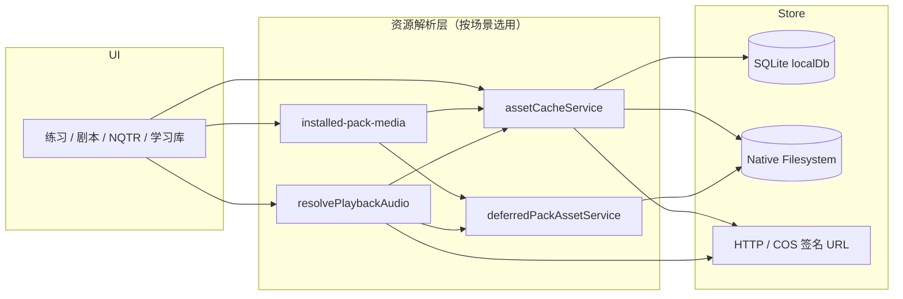

---

## 2. 总点：二进制怎么存 / 怎么播

> Web 与 Capacitor **真正分叉**就在这里。结构化 JSON / 学习库 / outbox 两端同套路；差别是：**字节落在哪、解析成什么 URL、谁能播**。

### 2.1 三层身份（别混）

| 层 | 例子 | 作用 |
|----|------|------|
| **查找身份**（不播） | Ink `alias`、`fileAssetId`、`asset://…`、过期 COS 签名 URL | 只用来查表；**不要**直接塞给 `` / `<audio>` / Pixi |
| **落盘形态**（存） | Native `file://…/offline-assets/{sha}.ext`；Web DEV `data:…`；保留 zip 内条目 | 真实字节在哪 |
| **播放 URL**（播） | WebView：`capacitor://` / `data:` / 签名 HTTPS / 同源 content；NativeAudio：`file://`；会话：`blob:` | 给播放器的最终字符串 |

SQLite **从不存二进制**。`local_assets` / `asset_refs` / `deferred_pack_assets` 只存元数据与指针。

### 2.2 字节存在哪（存）

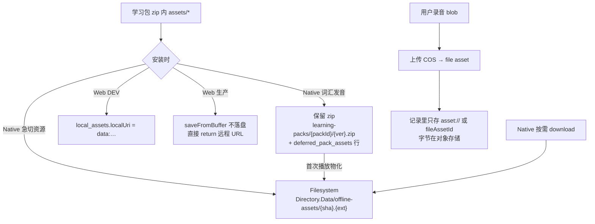

| 资源类型 | Capacitor（Native） | Web |
|----------|---------------------|-----|
| 包内背景 / 立绘 / VN 配音 | 安装（或 deferred 物化）后进 `offline-assets/`；`local_assets.localUri = file://` | **DEV**：可写成 `data:` 进 `local_assets`；**生产**：`saveFromBufferWithSha256` **不持久化**，返回远程 URL |
| 词汇美英发音 | 安装只登记 deferred；播时从保留 zip 抽出 → 同上资产池 | 安装**跳过**；播时 `getFileAssetPrivateUrl` 签名 URL |
| 未装包封面 / 商店图 | 可远程；命中缓存则本地 | 远程 / content URL |
| warmup / 学习库题面音频 | cache → deferred → download 进资产池 | 几乎总是刷新签名 URL |
| 用户录音（练习 / 剧本） | 上传 COS；本地只留 `asset://` / id | 同左 |
| 会话内预览录音 | `blob:` / 临时 native URL，**不入库存** | 同左 |

物理布局（仅 Native 有意义）：

```
Directory.Data/
├── offline-assets/{sha256}.{ext}     ← 已物化 / 已下载的唯一字节副本（SHA 去重）
└── learning-packs/{packId}/
    ├── {version}.zip                 ← deferred 音源；急切资源解完仍可能保留
    └── {version}.zip.previous        ← 更新中断时给旧 deferred 行用
```

写入入口：`assetCacheService.saveFromBufferWithSha256`（安装 / 物化）与 `assetCacheService.download`（Native 按需）。引用：`asset_refs`（packId + sha256）；卸载归零才删文件。

### 2.3 播成什么 URL（播）

播放器吃的不是「身份」，是下面其中一种：

| 消费者 | 需要的 URL | 怎么得到 |
|--------|------------|----------|
| WKWebView `` / `<audio>` / CSS | `capacitor://localhost/…`（或 `data:`） | `Capacitor.convertFileSrc(file://)` ≡ `toLoadableUrl` / `toWebViewPlaybackUrl` |
| Pixi 纹理（Native） | 不能直接啃 `capacitor://` 当 Texture 源 | `vnTextureRuntime`：`fetch → blob/ImageBitmap → Texture` |
| `@capgo/capacitor-native-audio` | 原始 `file://` | `resolvePlaybackAudio({ asFileUri: true })` |
| Web `<audio>` / `` | HTTPS 签名 URL 或同源 `/file-assets/:id/content` | `getFileAssetPrivateUrl` / `resolveUserRecordingPlaybackUrl` |
| 当前会话波形预览 | `blob:` | 录音组件即时 URL；**禁止写入服务端记录** |

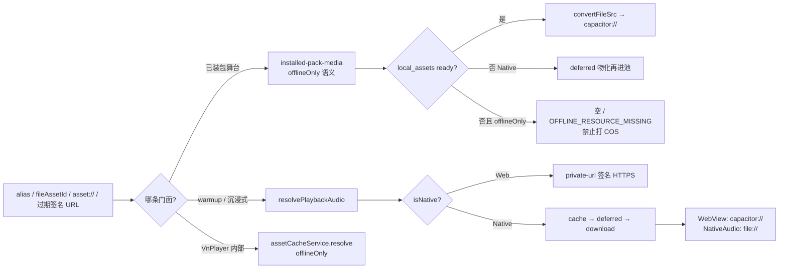

### 2.4 两条播门面（为什么不能合成一个）

| 门面 | 契约 | 典型场景 |
|------|------|----------|
| **`installed-pack-media` + `offlineOnly`** | 已装包必须能离线播完；**未命中禁止静默打 COS** | VN / 剧本 / NQTR 舞台 |
| **`resolvePlaybackAudio`** | 允许联网补全；Web 直接刷签名 URL | warmup、学习库沉浸式、包外发音 |

同一底层 `assetCacheService` +（Native）`deferredPackAssetService`；差别只在**缺本地时能不能联网**。

### 2.5 按场景：存 → 解析 → 播

| 场景 | 字节从哪来 | 解析 | 最终播 |
|------|------------|------|--------|
| 学习包 / 剧本 VN 背景立绘配音 | Native：`offline-assets`（或 deferred→池）；Web 生产多依赖远端身份 | `useInstalledVnMedia` → map/scene 本地化；VnPlayer `resolve(offlineOnly)` | WebView `capacitor://`；Pixi 再 blob 解码 |
| 跟读剧场 TTS | 同上（帧上已是解析后的 URL） | Mixed 内 `useOfflineAssetUrl` / 信任预解析 | `new Audio(url)` |
| NQTR | 进入时整包 `resolveInstalledNqtrBundle` | 预写进 bundle | `VnStoryPreview` |
| 知识点题面音 | Native 池或下载；Web 签名 URL | `useCachedAudio` → `resolvePlaybackAudio` | `<audio>` / NativeAudio |
| 用户录音回放 | COS 上的 file asset | `resolveUserRecordingPlaybackUrl` → 同源 content | `<audio>` |
| 学习库沉浸式 | 同题面音；可再 TTS | `resolvePlaybackAudio`（Native 常 `asFileUri`） | NativeAudio / Web audio |

### 2.6 一句话对照

- **存**：Native = 磁盘 SHA 池 + 可选保留 zip；Web 生产 = **基本不落本地二进制**，靠签名 / content URL 播；Web DEV 才把包资源写成 `data:` 方便本地调试。
- **播**：先把「身份」解析成「播放器能吃的 URL」；WebView 要 `capacitor://`，NativeAudio 要 `file://`，Web 网页要 HTTPS/同源；`blob:` 只活在当前会话。
- **已装包舞台**缺文件 = 报缺失，不偷跑 COS；**普通音频**可以下载或刷签名。

后续章节都是这个总点在安装、场景、学习库上的展开。

---

## 3. 学习包下载与安装

### 3.1 zip 结构（传输格式）

```
learning-pack-{packId}-v{version}.zip
├── pack-manifest.json
├── checksums.json
├── content/
│   ├── scene.json
│   ├── topics/{topicId}.json
│   ├── episodes/{episodeId}.json
│   ├── inks/{inkScriptKey}.json
│   ├── nqtr.json
│   └── indexes/
└── assets/
    ├── backgrounds/
    ├── characters/{charId}/
    └── audio/...
```

- 内容 JSON → SQLite（业务表 + 索引表 + read-model 投影）
- 急切资源 → 全局资产池 + `asset_refs`
- Native 延迟资源 → 只写 `deferred_pack_assets`，物理文件仍在保留 zip

### 3.2 入口与队列

| 触发 | 路径 |
|------|------|
| 加入学习 | `enrollUnit` → `enqueueDownloadTask` + `processDownloadQueue` |
| 手动下载 | `downloadUnitPack`（计划页 / 单元页 / 剧本中心 / 下载抽屉重试） |
| 版本检查 | `checkPackUpdates` → delta 则 `installDelta`，否则 `installUnit` |

队列规则：单路 FIFO；同 `packId` 再入队替换旧任务；任务持久化 `manyu.learning-pack.tasks.v1`；Native 蜂窝二次确认。

### 3.3 主流程图（Web / Native 同入口，资产分叉）

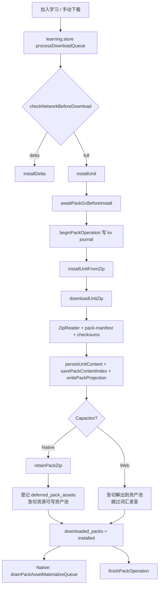

进度 step（只允许前进）：

`downloading` → `parsing` → `reading_manifest` → `reading_topics` → `persisting_content` → `indexing` → `extracting_assets` → `finishing`

资源提取并发：**Native = 2**，**Web = 20**。

### 3.4 downloadUnitZip 分叉

| 条件 | 行为 |
|------|------|
| Web，或 Native 非蜂窝 | `learningApi.downloadPack` → ArrayBuffer → Blob |
| Native 蜂窝 | `@capacitor/file-transfer` 写 `.zip.partial`，再 `convertFileSrc` → Blob（避免大文件 base64 readFile） |

Delta 始终走 `learningApi.downloadDelta`（无 FileTransfer 分支）。

### 3.5 安装后资产：Web vs Native

| | Web | Native |
|--|-----|--------|
| 保留 zip | 否 | `learning-packs/{packId}/{version}.zip` |
| 背景 / 立绘 / 配音 | 安装时急切写入资产池 | 急切写池或 deferred（按角色） |
| 词汇美英发音 | **跳过**（`shouldSkipWebVocabularyPronunciation`），播放走签名 URL | 只登记 `deferred_pack_assets`，首次播放物化 |
| 物化触发 | 无 | 安装后队列 + 播放时 `deferredPackAssetService.resolve` |

### 3.6 卸载

1. `uninstallMetadata`：删 SQLite 内容 / refs / deferred，入队 GC job（只删引用计数归零的 sha）
2. `drainPackGcQueue`：删文件、Native `rmdir(learning-packs/{packId})`、`discardPack`

崩溃恢复：`recoverInterruptedOperations` 读 `learning-pack-operation:*` journal → rollback 或 finish + GC。

---

## 4. 资源管理（共享层 API）

> 存/播总点见 [§2](#2-总点二进制怎么存--怎么播)。本节只列 API 与调用顺序。

### 4.1 AssetCache

物理路径（Native）：`Directory.Data/offline-assets/{sha256}.{ext}`

`resolve` 顺序：

1. 已是本地可加载 URL → 按需 `convertFileSrc`
2. 用 sha256 / fileAssetId / 稳定 URL / alias 查 `local_assets`（status=ready）
3. Native `Filesystem.stat`；文件丢了清坏记录
4. `offlineOnly` 且未命中 → `OFFLINE_RESOURCE_MISSING`
5. 非 offline：Web 常直接返回远程 URL；Native 可 download

Web 生产：`saveFromBufferWithSha256` **不写盘**（仅 DEV 写 `data:`）；`download()` 在 Web 上基本是透传 URL。

### 4.2 Deferred（仅 Native）

白名单角色：`vocabulary_pronunciation_us` / `vocabulary_pronunciation_uk`

首次播放：`resolve` → 打开保留 zip（同时只开一个 ZipReader）→ SHA 校验 → `saveFromBufferWithSha256` → 之后走普通资产池。

### 4.3 InstalledPackMedia（已装包专用，不回退 COS）

| API | 用途 |
|-----|------|
| `resolveInstalledMedia` | 单资源 |
| `resolveInstalledAssetMap` | Ink assetMap 整表本地化 |
| `resolveInstalledScene` | 场景背景 / 立绘 / avatar / expressions |
| `resolveInstalledNqtrBundle` | 探索包整包 URL 本地化 |
| `resolvePackDisplayUrl` | UI 封面：本地优先，未装才退远端 |

SQLite 存 `file://`；WKWebView 必须 `toWebViewPlaybackUrl` → `capacitor://`。

### 4.4 resolvePlaybackAudio（非舞台主链路）

用于 warmup、沉浸式、部分知识点音频——**允许联网补全**。流程见 §2.3–2.4。

- WebView `<audio>`：要 `capacitor://`
- `@capgo/capacitor-native-audio`：传 `asFileUri: true`，保留 `file://`

---

## 5. 练习场景资源加载与回放

共性：包内舞台资源走 **`useInstalledVnMedia` → installed-pack-media`**；VnPlayer 内再 `assetCacheService.resolve({ offlineOnly })`。用户录音持久化与回放另有一套（见下表）。

### 5.0 场景对照总表

| 场景 | 直播资源 | 用户录音持久化 | 回放入口 | 回放用户音频 |
|------|----------|----------------|----------|--------------|
| 学习包 VN / 场景对话 | `useInstalledVnMedia` + `VnPlayer offlineOnly` | `persistUserRecordingAsset` → `asset://` | `PracticeDialogueVnReplay` | `resolveUserRecordingPlaybackUrl` |
| 剧本包 VN | 同上 + 可选 `prepareStoryVnEntry` | 剧本页批量 COS → `recordingAssets` | `ScriptRecordVnReplay`（需已装包） | id → content URL |
| 跟读剧场 | `VnMixedPreviewPlayer` + 预解析 assetMap | 完成时 COS → `recordingAssets` | `RepeatRecordReplay` | `getFileAssetPrivateUrl` / frame map |
| NQTR VN | 一次性 `resolveInstalledNqtrBundle` + `VnStoryPreview` | 视具体玩法 | 依赖预解析 bundle | — |
| 知识点 warmup | `useCachedAudio` → `resolvePlaybackAudio` | 多为会话内 blob，随 warmup 记录 | `warmup-record-detail-dialog` | 存的 `audioUrl`（blob 可能失效） |

### 5.1 学习包：场景对话 / VN 练习

**页**：`practice-session-page.tsx`

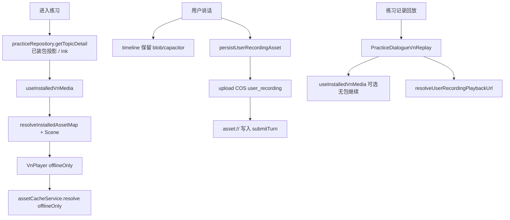

要点：

- 直播 UI 用短生命周期 blob；入库必须 `asset://`（blob 会话结束即死）。
- 回放允许**无包继续**（此时走线上资源）；与剧本回放「必须已装包」不同。

### 5.2 剧本包 VN 对话

**页**：`script-player-page.tsx`（`mode=vn`）

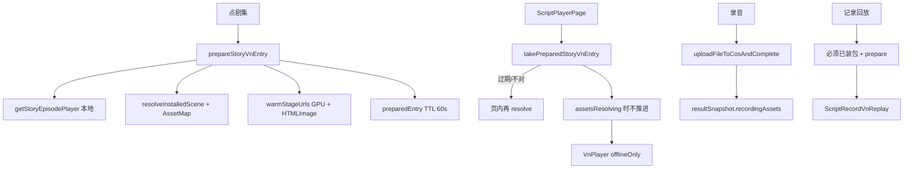

为何 `prepareStoryVnEntry`：移动端首帧避免黑屏；纹理与 HTML 图同时预热；Strict Mode 双挂载靠 TTL 缓存。

### 5.3 跟读剧场（repeat）

同页 `mode=repeat` → `buildStoryRepeatFrames` → **`VnMixedPreviewPlayer`**

- 视觉：帧内已带解析后的 URL；组件内 `useOfflineAssetUrl` → `assetCacheService.resolve`
- TTS：`new Audio(frame.audioUrl)`（信任预解析结果，不走 `resolvePlaybackAudio`）
- 用户跟读：会话内 Blob；完成上传 COS → `recordingAssets`
- 回放：`RepeatRecordReplay` 拉 private URL → `initialRecordingUrls`

### 5.4 NQTR VN

**页**：`nqtr-play-page.tsx`

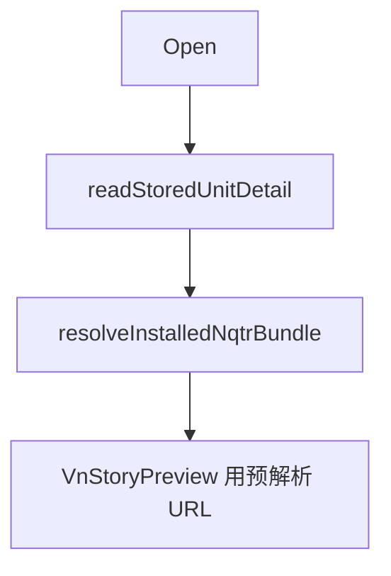

与学习/剧本不同：不挂 `useInstalledVnMedia` / 不强制 `VnPlayer offlineOnly`；依赖**进入时一次**本地化。缺资源时行为更「信任预解析」。

### 5.5 知识点练习：录音与回放

**页**：guided warmup / drill cards

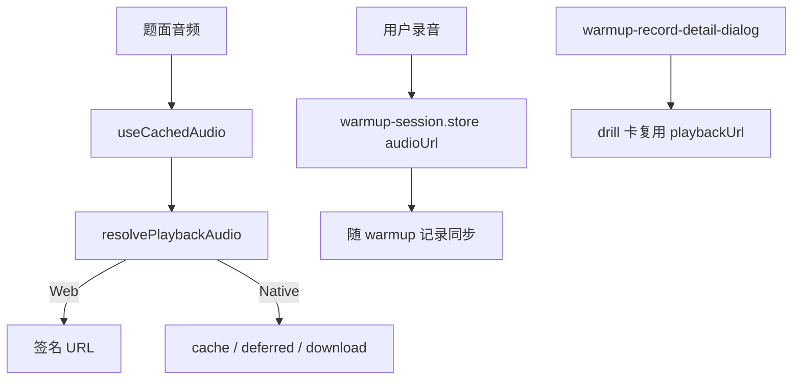

与 VN 的差异：

- 题面音频走 **`resolvePlaybackAudio`**（可联网），不是 installed-pack 的 `offlineOnly` 舞台契约。
- 用户录音**多数只保会话 URL**；不像 VN 一律 `persistUserRecordingAsset`。回放依赖记录里是否仍有有效 URL。

### 5.6 用户录音：统一身份 vs 分叉实现

| 方法 | 作用 | 为何需要 |
|------|------|----------|
| `persistUserRecordingAsset` | blob → COS → `asset://` | 练习会话结束后仍可回放 |
| `resolveUserRecordingPlaybackUrl` | `asset://` / UUID → 同源 content URL | **禁止回放 blob:** |
| 剧本页直接 `uploadFileToCosAndComplete` | 写入 `recordingAssets[frameIndex]` | 跟读/剧本按帧索引存，形状不同 |

已知分叉：练习用 `persistUserRecordingAsset`；剧本 VN / 跟读用页内批量上传。目标语义相同（durable file asset），入口未完全统一。

---

## 6. 单词 / 句型 / 句块存储与学习库

### 6.1 三层存储（不要混）

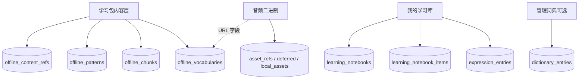

| 层 | 表 | 存什么 |
|----|-----|--------|
| 包内容正文 | `offline_vocabularies` / `offline_chunks` / `offline_patterns` + `offline_content_refs` | 安装时 `savePackContentIndex` 写入的完整 JSON |
| 学习库收藏 | `expression_entries` + `learning_notebook_items` + `learning_notebooks` | 薄快照 + 笔记本关系 + SM-2 字段 |
| 音频字节 | **不进 SQLite**；`asset_refs` / `deferred_pack_assets` / `local_assets` | 包内发音；Web 播签名 URL |

命名注意：内部 `kind=word|chunk|pattern`；API 句型常为 `scene_phrase`；refs 里 vocab 叫 `vocab` 不是 `word`。

### 6.2 音频如何存、如何播

细节总表见 [§2](#2-总点二进制怎么存--怎么播)。此处只盯「词句发音」：

| 端 | 包内词汇发音 | 播放入口 |
|----|--------------|----------|
| Native | deferred → 首次物化到 `offline-assets/` | `resolvePlaybackAudio` / immersive |
| Web | 安装跳过；JSON 里保留 assetId/URL | `getFileAssetPrivateUrl` |

展示层：`hydrateExpressionSnapshots()` 用 `offline_*` 按 `sourceId` / 归一化文本补全定义与音频字段。

### 6.3 存到「我的学习库」流程

入口：`expression-prep-section`、练习页、insight dialog、`SaveToNotebookDrawer` 等 → **`learningContentRepository.saveExpressionEntryAndSync`**

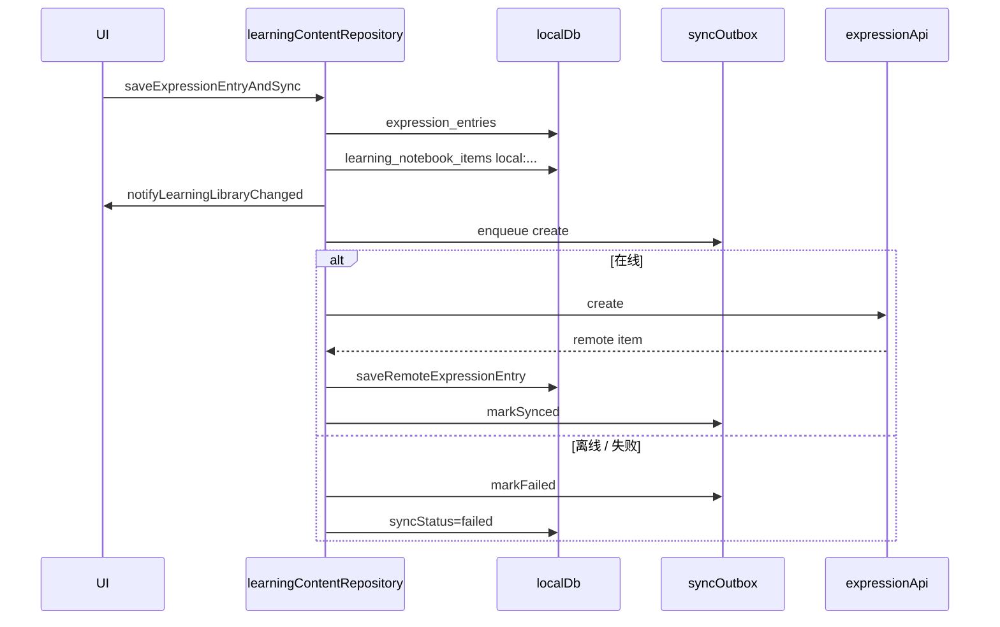

列表页（`expression-library-page`）**只读 SQLite**；笔记本名可后台 `learningNotebookRepository.refresh()`；手动同步 `offlineSyncService.sync(..., scope: 'notebook')`。

---

## 7. 离线数据 vs Web 请求

### 7.1 正确心智模型

> **不是**「Web = 只打接口，Capacitor = 只读本地」。  
> **是**「两端都以 SQLite 为用户数据主存；Web 与 Native 的分叉主要在**二进制资源与播放管线**」——展开见 [§2](#2-总点二进制怎么存--怎么播)。

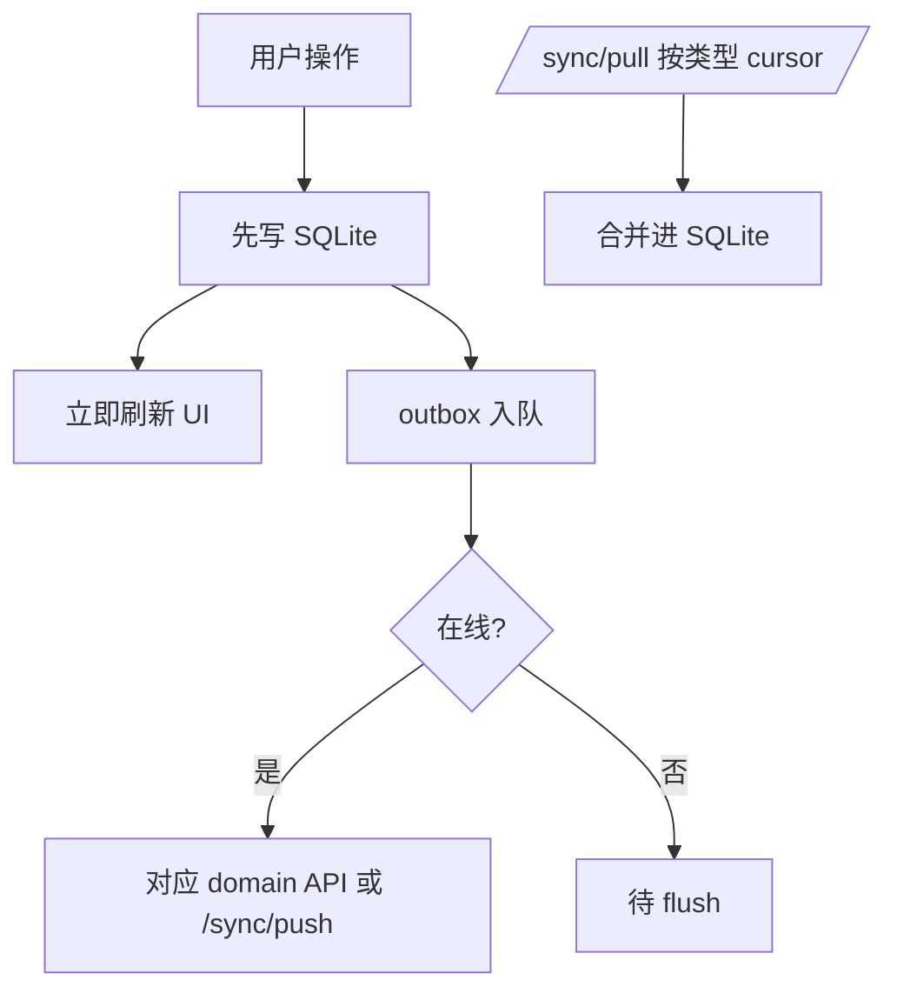

### 7.2 按领域：本地优先还是直打 API

| 领域 | 读 | 写 |
|------|----|----|
| 已装包 topic / Ink / 场景 | **仅本地包**（`practiceRepository.getTopicDetail` 不静默打线上 topic） | — |
| 剧集播放器 | 已装包优先；否则 `getStoryEpisodePlayer` API | — |
| 我的学习单元 | cache → `getMyUnits` | enroll/quit：本地 + outbox + HTTP |
| 练习会话 / turn | 本地记录 | 本地 + outbox |
| 学习库表达 | SQLite 列表 | `saveExpressionEntryAndSync` |
| 笔记本 CRUD | cache → API 镜像 | HTTP + 写回 SQLite |
| 练习历史 | 本地分页；空则 API | — |
| 封面 / 未装包媒体 | 可远端 | — |
| 已装包 VN 媒体 | **禁止远端**（offlineOnly） | — |

### 7.3 `isNative()` 真正影响什么

- zip FileTransfer / 保留 zip / deferred
- Filesystem 资产池与 `convertFileSrc`
- NativeAudio `file://`
- 蜂窝确认、部分移动端 UX  

**不**决定「笔记本是否进 SQLite」——Web 同样进 jeep-sqlite。

---

## 8. 关键方法选用表与冗余说明

### 8.1 该用哪条链路

| 需求 | 应使用 | 不要用 |
|------|--------|--------|
| 已装包背景/立绘/Ink 配音 | `useInstalledVnMedia` / `installed-pack-media` + `offlineOnly` | 裸 COS URL；随意 `resolvePlaybackAudio` 当舞台主路径 |
| warmup / 沉浸式 / 学习库发音 | `resolvePlaybackAudio` / `useCachedAudio` | `installed-pack-media`（无 pack 上下文） |
| UI 封面 | `resolvePackDisplayUrl` / `usePackDisplayUrl` | 直接拼 signed URL |
| 用户录音持久化 | `persistUserRecordingAsset`（或剧本等价 COS 上传） | 把 `blob:` 写进服务端记录 |
| 用户录音回放 | `resolveUserRecordingPlaybackUrl` | 直接播历史 blob |
| 存学习库 | `saveExpressionEntryAndSync` | 只调 API 不写本地 / 只写本地不入 outbox |
| 包安装 | `learning.store` 队列 → `learningPackService.installUnit` | 页面内私自下载 zip |

### 8.2 为何拆成多条解析链（有意为之）

1. **`installed-pack-media`**：契约是「已装包 = 可离线播完」；失败必须显式缺失，不能静默打 COS 造成「以为离线其实在耗流量 / 失败难查」。
2. **`resolvePlaybackAudio`**：学习库 / warmup 资源可能从未装进包（Web 跳过发音、或用户收藏的外部资产），需要签名 URL / 按需下载。
3. **`assetCacheService`**：底层统一池；上层两个门面施加不同网络策略。
4. **`deferredPackAssetService`**：Native 安装体积与首次打开时间权衡；Web 不需要保留 zip。

### 8.3 已知冗余 / 分叉（流程能跑通，但认知成本高）

| 现象 | 说明 | 建议态度 |
|------|------|----------|
| `Capacitor.isNativePlatform` vs `isNative()` | 同义，import 不统一 | 新代码统一 `isNative()` |
| 练习录音 vs 剧本录音上传 | 两套入口，都落到 file asset | 长期收敛到 `persistUserRecordingAsset` |
| `useCachedAudio` / VnPlayer 内 `useCachedAssetUrl` / Mixed 的 `useOfflineAssetUrl` | 重叠的「解析后播放」钩子 | 舞台走 offlineOnly；普通音频走 playback-audio |
| NQTR 不走 `VnPlayer offlineOnly` | 依赖一次性 bundle resolve | 文档与评审时单独记 |
| 练习回放可无包 / 剧本回放强制有包 | 产品策略不同 | 保持，但入口注释写清 |
| `createPayload` vs `createRequest` | outbox 与即时 API 双形状 | 可合并，非功能 bug |
| `learning-pack-read-model` vs legacy `aggregateUnitContent` | 投影与旧整包 blob 并存 | 新读路径只用 read-model |
| `offline_*` / `expression_entries` / `dictionary_entries` | 三套「词」表职责不同 | 见 §5；勿合并表，合并心智 |

> 结论：两端主流程正确；问题主要是**多门面 + 历史双路径**，不是「有的地方完全自己造了一套离线系统」。新功能优先挂现有 repository / installed-pack-media / playback-audio / outbox，避免再开第四条资源解析链。

---

## 9. 离线存储与数据结构

### 9.1 SQLite（`speakguild_offline`）

表按「id + data JSON + 索引列」；二进制不进库。

| 表名 | 用途 |
|------|------|
| `downloaded_packs` | 已安装包 + manifest |
| `downloaded_unit_details` | read-model 投影行 |
| `ink_scripts` | Ink JSON |
| `offline_vocabularies` / `offline_chunks` / `offline_patterns` | 包内容正文 |
| `offline_content_refs` | 内容 ↔ 包引用与排序 |
| `expression_entries` / `learning_notebooks` / `learning_notebook_items` | 学习库 |
| `local_assets` / `asset_refs` / `deferred_pack_assets` | 资源元数据 |
| `pack_events` | 安装审计 |
| `warmup_*` / `daily_practice_*` | 知识点 / 今日任务 |
| `outbox` / `kv` | 同步与安装 journal |

### 9.2 Native 文件布局

```
Directory.Data/
├── offline-assets/{sha256}.{ext}
└── learning-packs/{packId}/{version}.zip
                  └── {version}.zip.previous
```

### 9.3 存储管理

`offline-storage.service`：统计、清包、清资产、按用户擦除练习数据。登出可保留已装学习包（owner key：`manyu-offline-data-owner`）。

---

## 10. 学习计划与今日任务

```text
学习计划 = 用户选择的内容池（最多 3 个未完成单元）
今日任务 = 从已安装学习包按天抽取的输出训练（本地生成，不依赖 /learning/today 主链路）
```

1. `getMyUnits()` 本地优先  
2. 未安装阻止进入详情并引导下载  
3. 加入学习：本地 + outbox → start API → `enqueueDownloadTask`  
4. 今日任务音频：`useCachedAudio` / `resolvePlaybackAudio`

---

## 11. 数据同步（outbox + pull）

```
用户操作 → 本地 SQLite → outbox → 在线 flush / 即时 HTTP
```

- warmup → `/sync/push`
- 今日任务 complete → `/practice/daily-practice/complete`（失败入队）
- 表达库 → 本地 + outbox；在线可立即 `expressionApi.create` 后 `markSynced`
- `/sync/pull`：**按类型独立 cursor**，分页直到 `hasMore=false`
- `contentManifest` 变更可标陈旧包并触发再安装

---

## 12. 沉浸式播放器

入口：表达库 / 知识点 → `mapInsightItemsToImmersiveItems` → `ImmersivePlayerDialog`。  
与 VN 舞台是不同产品面。

- Web：`useCachedAudio` + 按需 TTS  
- Native：NativeAudio + Media Session；解析用 `resolvePlaybackAudio(..., asFileUri: true)`

---

## 13. 边界处理与风险

| 场景 | 当前处理 | 状态 |
|------|----------|------|
| App 杀死于安装中 | journal + recover / rollback | ✅ |
| 网络中断于安装 | AbortError → error + 回滚 | ✅ |
| 多包同时装 | 单路 FIFO | ✅ |
| 蜂窝下载 | 二次确认；Native FileTransfer | ✅ |
| 已装包缺资源 | offlineOnly，不打 COS | ✅ |
| deferred zip 丢失 | 物化失败，需重装 | ⚠️ |
| VN 开场黑屏 | 依赖 prepare + assetsResolving | ⚠️ |
| warmup 回放 blob | 会话结束后可能失效 | ⚠️ |
| 锁屏后台 VN | 未与沉浸式同级验收 | ⚠️ |

---

## 14. 后续规划

- Delta 规模化与失败降级观测
- 用户录音持久化入口收敛到 `persistUserRecordingAsset`
- 音频钩子收敛（舞台 offlineOnly vs `resolvePlaybackAudio` 边界写进 lint/注释）
- `installUnitFromZip` 拆模块
- sync `replayItem` 注册制 handler
- VN / 沉浸式后台播放真机验收

---

## 15. 相关文档

- [漫语町剧本包设计与剧情圣经](./漫语町剧本包设计与剧情圣经.md)
- [部署环境变量参考](./部署环境变量参考.md)
- [learning-md-writing-rules](./learning-md-writing-rules.md)
